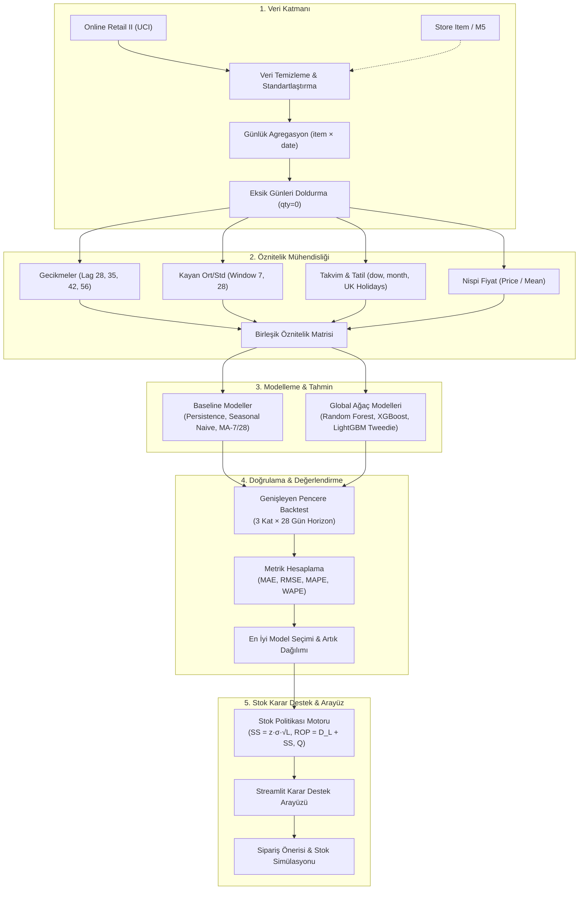

# Küçük İşletmeler İçin Yapay Zekâ Destekli Stok Talep Tahmin Sistemi
## Proje ve Geliştirici Kılavuzu (Sprint 1 – Sprint 10)

> **Proje Türü:** Bilgisayar / Endüstri / Yazılım Mühendisliği Bitirme Projesi  
> **Ekip:** 4 Kişi (Ö1, Ö2, Ö3, Ö4)  
> **Süre:** 10 Hafta (10 Sprint) — Başlangıç: 26 Ekim Pazartesi  
> **GitHub:** [https://github.com/TNNladie/stok-talep-tahmin](https://github.com/TNNladie/stok-talep-tahmin)  
> **ClickUp Proje Panosu:** [Stok_Talep_Tahmin_Proje](https://app.clickup.com/90182849410/v/o/s/1100390000090695)

---

## 1. Proje Özeti ve Amacı

Küçük ve orta ölçekli işletmeler (KOBİ'ler/SMB'ler), genellikle yetersiz sermaye ve sınırlı depolama alanı ile çalışırlar. Aşırı stoklama yüksek taşıma maliyetine ve sermaye bağlanmasına yol açarken, stoksuz kalma (*stockout*) satış kaybı ve müşteri memnuniyetsizliği yaratır.

Bu projenin temel amacı:
1. Geçmiş günlük satış verilerini kullanarak ürün bazında **28 günlük dinamik talep tahmini** üretmek,
2. Bu tahminleri ve tahmin belirsizliğini (hata varyansını) kullanarak **Güvenlik Stoku (Safety Stock - SS)** ve **Yeniden Sipariş Noktası (Reorder Point - ROP)** hesaplamak,
3. İşletme yöneticisinin karar almasını kolaylaştıran interaktif bir **Streamlit Karar Destek Sistemi** sunmaktır.

---

## 2. Uçtan Uca Mimari ve Akış Şeması



---

## 3. Veri Setleri Rehberi

| Veri Seti | Rolü | Boyut / Özellik | Erişim ve İndirme |
|---|---|---|---|
| **Online Retail II (UCI)** | **Ana Veri Seti** | ~1M satır (2009–2011), Birleşik Krallık merkezli hediyelik eşya perakendecisi. | `python -m src.data.download --source online_retail_ii` |
| **Store Item Demand (Kaggle)** | **Doğrulama / Kontrol** | 10 mağaza × 50 ürün, 5 yıllık temiz günlük satış verisi. | `python -m src.data.download --source store_item` |
| **M5 Forecasting (Kaggle)** | **İsteğe Bağlı Stres Testi** | Walmart hiyerarşik perakende verisi, aralıklı (*intermittent*) talep. | Kaggle API üzerinden opsiyonel |

### Temizleme ve Standardizasyon Kuralları:
- İptal ve iade faturaları (`Invoice` değeri `C` ile başlayanlar) filtrelenir.
- Hatalı satırlar ($Quantity \le 0$ veya $Price \le 0$) atılır.
- Varsayılan olarak en yüksek hacimli pazar (`United Kingdom`) ve en çok satan `top_n_items: 50` filtrelenir.
- Satış olmayan günler **sıfır talep ($qty=0$)** olarak seriye eklenir (Zaman serisi sürekliliği için zorunludur).

---

## 4. Modeller ve Matematiksel Altyapı

### 4.1. Baseline Modeller
1. **Persistence (Naive):** $y_{t+h} = y_t$
2. **Seasonal Naive:** $y_{t+h} = y_{t+h-7}$ (Haftalık mevsimselliği yineler)
3. **Moving Average (MA-7, MA-28):** Son $k$ günün aritmetik ortalaması

### 4.2. Makine Öğrenmesi Modelleri
Tüm ürünlerin tek bir modelde eğitildiği **Global Model** yaklaşımı benimsenmiştir:
- **Random Forest:** Aşırı öğrenmeye dayanıklı topluluk (*ensemble*) modeli.
- **XGBoost:** Gradyan artırma ile doğrusal olmayan ilişkileri ve trendleri yakalama.
- **LightGBM (Tweedie Dağılımı):** Sıfır talep yoğunluklu (aralıklı/intermittent) perakende serileri için `objective="tweedie"` optimize edilmiştir.

### 4.3. Öznitelik Mühendisliği & Veri Sızıntısı Koruması
*Veri Sızıntısını (Data Leakage)* önlemek için tüm lag ve kayan pencere öznitelikleri en az **tahmin ufku kadar ($horizon = 28$) geriye kaydırılmıştır**:
- $Lag_{28}, Lag_{35}, Lag_{42}, Lag_{56}$
- $t-28$ gün üzerinden $7$ ve $28$ günlük hareketli ortalama ve standart sapma.

---

## 5. Stok Yönetim Politikası ve Formülasyonlar

Sistem dinamik talep tahminlerini ve tahmin belirsizliğini girdi alarak **Yeniden Sipariş Noktası ($s, S$) / Sürekli Gözden Geçirme** politikasını uygular:

1. **Güvenlik Stoku (Safety Stock - $SS$):**
   $$SS = z \cdot \sigma_e \cdot \sqrt{L}$$
   - $z$: İstenen hizmet düzeyi için standart normal sapma (Örn: $\%95$ hizmet düzeyi için $z \approx 1.645$)
   - $\sigma_e$: En iyi tahmin modelinin doğrulama katlarındaki artık standart sapması (*residual std*)
   - $L$: Tedarik süresi (*lead time*, gün cinsinden, varsayılan 7 gün)

2. **Yeniden Sipariş Noktası (Reorder Point - $ROP$):**
   $$ROP = D_L + SS = \sum_{t=1}^{L} \hat{y}_t + SS$$
   - $D_L$: Tedarik süresi boyunca beklenen kümülatif talep tahmini.

3. **Sipariş Miktarı ($Q$):**
   Eldeki stok $I_{on\_hand} \le ROP$ ise sipariş tetiklenir:
   $$Q = \max\left(0, \sum_{t=1}^{L+R} \hat{y}_t + SS - I_{on\_hand}\right)$$
   ($R$: Gözden geçirme periyodu, varsayılan 7 gün).

---

## 6. Değerlendirme Metrikleri

Tahmin başarısı 4 temel metrikle ölçülür:

- **MAE (Mean Absolute Error):** $\frac{1}{n}\sum |y - \hat{y}|$
- **RMSE (Root Mean Squared Error):** $\sqrt{\frac{1}{n}\sum (y - \hat{y})^2}$
- **MAPE (Mean Absolute Percentage Error):** $\frac{100\%}{|y>0|} \sum_{y>0} |\frac{y - \hat{y}}{y}|$
- **WAPE (Weighted Absolute Percentage Error):** $\frac{\sum |y - \hat{y}|}{\sum y} \times 100\%$ *(Sıfır talep günlerinde kararlı çalışan temel metrik)*

---

## 7. Rol Sorumluluk Matrisi

| Rol | Unvan / Odak | Temel Sorumluluklar | İlgili Dizinler / Dosyalar |
|---|---|---|---|
| **Ö1** | **Veri Mühendisi & Analist** | UCI Online Retail II verisini indirme, temizleme, eksik günleri doldurma, EDA notebook'ları hazırlama, veri sözlüğü ve literatür taraması. | `src/data/`, `notebooks/01_eda.ipynb`, `docs/data_dictionary.md` |
| **Ö2** | **Zaman Serisi & Değerlendirme** | Baseline modeller (Persistence, SNaive, MA), Prophet/ARIMA karşılaştırmaları, rolling-window backtest motoru, hata metrikleri. | `src/models/baselines.py`, `src/evaluation/`, `notebooks/02_baselines.ipynb` |
| **Ö3** | **ML & Stok Optimizasyonu** | Öznitelik üretimi (lag/rolling/takvim), Random Forest, XGBoost, LightGBM modelleri, hiperparametre optimizasyonu, güvenlik stoku ve stok simülasyonu. | `src/features/`, `src/models/ml.py`, `src/inventory/`, `notebooks/03_ml_experiments.ipynb` |
| **Ö4** | **Entegrasyon & DevOps / Arayüz** | Streamlit karar destek ekranı, uçtan uca pipeline entegrasyonu, pytest birim testleri, CI/CD GitHub Actions iş akışı, kod kalitesi (ruff), repo düzeni. | `app/`, `src/pipeline.py`, `tests/`, `.github/workflows/` |

---

## 8. 10 Haftalık Detaylı Sprint Yol Haritası

```
Sprint 1: Altyapı, Kurulum & Sentetik Pipeline Doğrulama
Sprint 2: Gerçek Veri (Online Retail II) Entegrasyonu & EDA
Sprint 3: Gelişmiş Öznitelik Mühendisliği & İlk ML Çıktıları
Sprint 4: LightGBM Tweedie & Model Kıyaslama Benchmark'ı
Sprint 5: Hiperparametre Optimizasyonu & Ara Değerlendirme
Sprint 6: Dinamik Güvenlik Stoku & Sipariş Politikası Motoru
Sprint 7: Streamlit Karar Destek Arayüzü v1.0
Sprint 8: Model Dayanıklılığı (Store Item Verisi ile Karşılaştırma)
Sprint 9: Stok Simülasyonu & Maliyet Analizi (Stoksuz Kalma vs Taşıma)
Sprint 10: Uçtan Uca Test, Bitirme Raporu & Final Demosu
```

### Sprint Detayları ve Teslim Edilecekler:

- **Sprint 1 (Hafta 1):**
  - Tüm ekip ortamı kurar (`uv` / `venv`, `pip install -r requirements.txt`, `pytest`).
  - Ö1: UCI Online Retail II veri yapısını inceler, ilk EDA notebook'unu açar.
  - Ö2: Baseline modellerin sentetik verideki davranışını analiz eder.
  - Ö3: Mevcut öznitelik setini (`src/features/build.py`) inceler ve yeni öznitelik önerileri çıkarır.
  - Ö4: GitHub CI workflow'unu ve demo pipeline'ı doğrular.

- **Sprint 2 (Hafta 2):**
  - Ö1: Gerçek veride veri temizleme betiğini test eder; eksik gün, iade ve aykırı değer raporu sunar.
  - Ö2: Gerçek veride baseline modellerin (Persistence, MA, SNaive) metriklerini çıkarır.
  - Ö3: Kategori ve fiyat bazlı yeni öznitelikler ekler.
  - Ö4: Streamlit arayüzünde gerçek veri yükleme desteğini genişletir.

- **Sprint 3 (Hafta 3):**
  - Ö1: Veri sözlüğü dokümanını tamamlar (`docs/veri_sozlugu.md`).
  - Ö2: Genişleyen pencere doğrulamasında kat sayısı ve pencere boyutunu test eder.
  - Ö3: Random Forest ve XGBoost modellerinin temel hiperparametrelerini ayarlar.
  - Ö4: Model tahmin sonuçlarını Parquet formatında saklama ve karşılaştırma testlerini yazar.

- **Sprint 4 (Hafta 4):**
  - Ö1: Top 50 ürün dışında kalan düşük hacimli ürünlerdeki talep örüntüsünü inceler.
  - Ö2: WAPE ve MAPE metriklerinin ürün bazlı dağılım grafiklerini oluşturur.
  - Ö3: LightGBM Tweedie kaybı hiperparametrelerini sıfır talep yoğunluğuna göre optimize eder.
  - Ö4: Streamlit arayüzüne model karşılaştırma tablosu ekler.

- **Sprint 5 (Hafta 5 - Ara Rapor & Sunum Hazırlığı):**
  - Ekip: Akademik danışmana sunulacak ara rapor taslağını oluşturur.
  - Ö2 & Ö3: Baseline vs ML sonuçlarının özet kıyaslama raporunu üretir.
  - Ö4: Projenin çalışan demosunu video/sunum formatında hazırlar.

- **Sprint 6 (Hafta 6):**
  - Ö1 & Ö3: Tedarik süresi belirsizliği senaryolarını modeller.
  - Ö3: `src/inventory/policy.py` içerisinde farklı hizmet seviyeleri (%90, %95, %99) için $SS$ ve $ROP$ hesaplamalarını tamamlar.
  - Ö2: Tahmin hatalarının normallik varsayımını inceler (artık histogramları).
  - Ö4: Birim stok maliyeti ve stoksuz kalma ceza maliyeti parametrelerini config'e bağlar.

- **Sprint 7 (Hafta 7):**
  - Ö4: Streamlit UI'da Plotly grafiğine güven aralıklarını ve sipariş noktası çizgisini ekler.
  - Ö1: Kullanıcı için CSV yükleme şablonu ve veri doğrulama kontrolleri yazar.
  - Ö3: Monte Carlo tabanlı stok seviyesi simülasyonunu arayüze entegre eder.

- **Sprint 8 (Hafta 8 - Çapraz Doğrulama):**
  - Ekip: Kaggle Store Item Demand veri seti üzerinde pipeline'ı çalıştırarak genellenebilirliği test eder.
  - Ö2: İki veri seti arasındaki model performans farklarını raporlar.

- **Sprint 9 (Hafta 9):**
  - Ö3 & Ö4: Sistem performansını optimize eder (tahmin önbellekleme / `@st.cache_data`).
  - Ö1 & Ö2: Literatür taraması ve ilgili çalışmalar bölümünü tamamlar.

- **Sprint 10 (Hafta 10 - Final):**
  - Tüm testlerin (`pytest`) ve kod stilinin (`ruff`) hatasız çalıştığı doğrulanır.
  - Final raporu, sunum slaytları ve canlı demo provası tamamlanır.

---

## 9. Geliştirici Çalışma Kuralları & Git Pratikleri

1. **`main` Dalı Korumalıdır:** Doğrudan `main` dalına push yapılmaz.
2. **Dal İsimlendirme Formatı:**
   - Yeni özellik: `feat/<rol>-<gorev-adi>` (Örn: `feat/o1-clean-returns`)
   - Hata düzeltme: `fix/<rol>-<hata-adi>` (Örn: `fix/o3-tweedie-nan`)
   - Dokümantasyon: `docs/<konu>` (Örn: `docs/data-dictionary`)
3. **Pull Request (PR) Standardı:**
   - Her PR ClickUp görevine referans vermelidir.
   - PR açılmadan önce lokalde testler ve stil denetimi çalıştırılmalıdır:
     ```bash
     ruff check src app tests
     python -m pytest -q
     ```
   - PR en az **1 ekip arkadaşı** tarafından incelenip onaylanmadan birleştirilemez.
4. **ClickUp Entegrasyonu:**
   - Göreve başlandığında ClickUp'ta durum: `In Progress`.
   - PR açıldığında: `In Review`.
   - Merge edilip testler geçtiğinde: `Tamamlandı`.

---

## 10. Yerel Kurulum Kılavuzu

```bash
# 1. Repoyu klonlayın
git clone https://github.com/TNNladie/stok-talep-tahmin.git
cd stok-talep-tahmin

# 2. Python 3.11 sanal ortamı oluşturun ve aktif edin
# Windows:
python -m venv .venv
.venv\Scripts\activate

# macOS / Linux:
# python3.11 -m venv .venv
# source .venv/bin/activate

# 3. Bağımlılıkları yükleyin
pip install -r requirements.txt

# 4. Testleri çalıştırın
python -m pytest -q

# 5. Sentetik veri ile uçtan uca akışı test edin
python -m src.pipeline --demo

# 6. Streamlit karar destek arayüzünü başlatın
streamlit run app/streamlit_app.py
```
