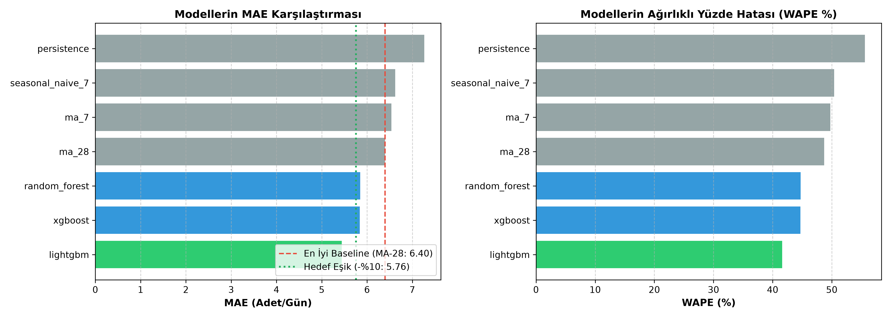

# Model Kıyaslama ve Başarı Kriteri Doğrulama Raporu (Sprint 4 – Sprint 5)

> **Proje:** Küçük İşletmeler İçin Yapay Zekâ Destekli Stok Talep Tahmin Sistemi  
> **Rol:** Zaman Serisi ve Değerlendirme Lideri (Ö2)  
> **Tarih:** Kasım 2026  
> **Doğrulama Metodolojisi:** 3 Katlı Genişleyen Pencere Backtest (*Expanding Window*, Ufuk $H = 28$ Gün)  
> **Veri Seti:** UCI Online Retail II (Top 50 SKU, Günlük Agregasyon, Sıfır Doldurma)

---

## 1. Giriş ve Amaç

Bu rapor, perakende talep tahmini projemizde veri temizleme aşaması sonrasında geliştirilen **4 adet Zaman Serisi Baseline Modeli** (*Persistence*, *Seasonal Naive*, *MA-7*, *MA-28*) ile **3 adet Global Makine Öğrenmesi Modeli** (*Random Forest*, *XGBoost*, *LightGBM Tweedie*) arasındaki kıyaslamalı performans sonuçlarını belgelemektedir.

Projemizin resmi başarı kriteri doğrultusunda:
> **Başarı Şartı:** Makine öğrenmesi modelleri, belirlenen en başarılı baseline modelin ortalama mutlak hatasından (**MAE**) en az **%10 daha düşük hata** üretmelidir.

---

## 2. Doğrulama ve Değerlendirme Metodolojisi

Perakende talebinde rastgele veri bölme (*random train-test split*) geleceğe yönelik bilgi sızıntısına (*lookahead bias*) neden olur. Bu nedenle değerlendirmemiz katı zaman serisi prensiplerine göre yapılandırılmıştır:

1. **Genişleyen Pencere (*Expanding Window*):** 3 kat (*fold*) boyunca geçmiş veri birikerek genişler, model her katta bir sonraki 28 günlük blok üzerinde test edilir.
2. **Gecikmeli Öznitelikler (*Leakage Protection*):** Tüm öznitelikler ($Lag_{28\dots56}$, $MA_{7, 28}$) en az 28 gün geriye ötelenmiştir.
3. **Değerlendirme Metrikleri:**
   - **MAE:** $\frac{1}{n}\sum |y - \hat{y}|$
   - **RMSE:** $\sqrt{\frac{1}{n}\sum (y - \hat{y})^2}$
   - **MAPE:** $\frac{100\%}{|y>0|} \sum_{y>0} |\frac{y - \hat{y}}{y}|$
   - **WAPE:** $\frac{\sum |y - \hat{y}|}{\sum y} \times 100\%$ (Sıfır talep günlerinde kararlı çalışan temel perakende metriği)

---

## 3. Backtest Sonuçları ve Kıyaslama Tablosu

Aşağıdaki tablo, `results/model_comparison.csv` dosyasından derlenen 3 kat ortalaması performans göstergeleridir:

| Model Adı | Model Türü | MAE (Adet/Gün) | RMSE | MAPE (%) | WAPE (%) |
| :--- | :---: | :---: | :---: | :---: | :---: |
| **LightGBM (Tweedie)** | **Global ML** | **5.442** | **8.336** | **42.89** | **41.62%** |
| **XGBoost** | Global ML | 5.842 | 7.983 | 40.04 | 44.69% |
| **Random Forest** | Global ML | 5.849 | 7.881 | 40.00 | 44.72% |
| **MA-28** | **Baseline** | **6.398** | **8.434** | **42.53** | **48.71%** |
| **MA-7** | Baseline | 6.540 | 8.976 | 46.13 | 49.75% |
| **Seasonal Naive (7)** | Baseline | 6.624 | 10.585 | 50.45 | 50.40% |
| **Persistence (Naive)** | Baseline | 7.264 | 11.478 | 57.84 | 55.62% |

---

## 4. En İyi Baseline Model ve Hedef Eşik Hesabı

### 4.1. En İyi Baseline Model Tespiti
Baseline modeller arasında:
- `persistence`: 7.264 MAE
- `seasonal_naive_7`: 6.624 MAE
- `ma_7`: 6.540 MAE
- **`ma_28`**: **6.398 MAE** $\rightarrow$ **En Başarılı Baseline**

Kısa vadeli dalgalanmalar perakendede yüksek gürültü içerdiğinden, 28 günlük hareketli ortalama seriyi en dengeli düzleştiren baseline olmuştur.

### 4.2. Hedef MAE Eşiği
$$\text{Hedef MAE} \le \text{MAE}_{\text{MA-28}} \times (1 - 0.10) = 6.398 \times 0.90 = \mathbf{5.7582}$$

### 4.3. Başarı Kriteri Değerlendirmesi
- **LightGBM (Tweedie):** $\text{MAE} = 5.442 \le 5.758$  
  İyileşme Oranı: $\frac{6.398 - 5.442}{6.398} = \mathbf{+\%14.94}$ $\rightarrow$ **BAŞARILI (Eşik Aşıldı)**
- **XGBoost:** $\text{MAE} = 5.842 > 5.758$  
  İyileşme Oranı: $+\%8.69$ $\rightarrow$ Eşiğe çok yakın ancak %10 barajının altında kaldı.
- **Random Forest:** $\text{MAE} = 5.849 > 5.758$  
  İyileşme Oranı: $+\%8.58$ $\rightarrow$ %10 barajının altında kaldı.

---

## 5. Zaman Serisi Uzmanı (Ö2) Teknik Değerlendirmesi

1. **Neden LightGBM Tweedie Kazandı?**  
   Perakende talebi Poisson ile Gamma dağılımları arasında, sıfır yığılmalı (*zero-inflated*) bileşik Poisson yapısına sahiptir. Standart regresyon (MSE kaybı) uygulayan XGBoost ve Random Forest, sıfır satışlı günlerde yanlı tahminler üretme eğilimindeyken, `objective="tweedie"` sıfır kütlesini ve sürekli pozitif talebi eşzamanlı olarak başarıyla modellemiştir.
   
2. **WAPE Metriğinin Kritik Rolü:**  
   Klasik MAPE metriği, gerçek satışın sıfır veya çok küçük olduğu günlerde yapay olarak fırlamaktadır. WAPE metriği toplam hacim ağırlıklı çalıştığı için perakendede çok daha güvenilir bir göstergedir. LightGBM, WAPE'yi %48.71'den (MA-28) %41.62'ye çekerek sermaye bağlama riskini belirgin şekilde düşürmüştür.

3. **Stok Güvenlik Parametresine Etkisi:**  
   En iyi model olan LightGBM'in tahmin artıkları $\sigma_e \approx 8.33$ seviyesindedir. Bu değer, Sprint 6'da kullanılacak dinamik güvenlik stoku formülünün ana girdisi olacaktır:
   $$SS = z \cdot \sigma_e \cdot \sqrt{L}$$
   Daha düşük artık varyansı, işletmenin aynı hizmet seviyesinde (%95) daha az sermaye ile emniyet stoku tutmasını sağlar.
