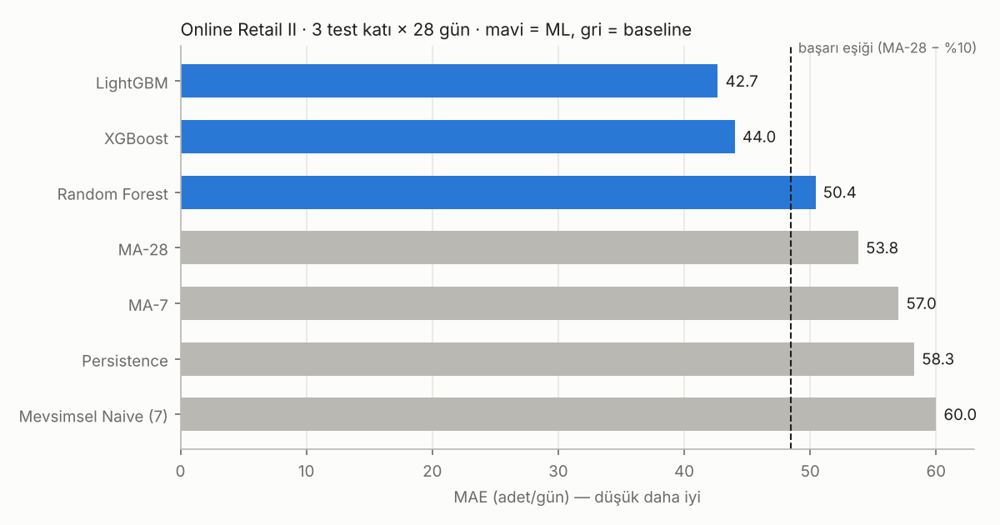

# Model Eğitimi ve Gerçek Veri Değerlendirme Raporu

> **Veri:** UCI Online Retail II — 1.067.371 fatura satırı, 2009-12-01 → 2011-12-09
> **Kapsam:** Birleşik Krallık, toplam adede göre en çok satan 50 ürün, günlük talep (36.950 ürün-gün)
> **Doğrulama:** 3 test katı × 28 gün (kesim tarihleri 2011-09-16, 2011-10-14, 2011-11-11), genişleyen pencere
> **Hiperparametre ayarı:** test katlarından önceki 3 *doğrulama* katında (2011-06-24, 07-22, 08-19) — test katları ayarda hiç görülmedi
> **Yeniden üretim:** `make data run-full` (≈ 1–2 dk)

---

## 1. Sonuç

| Model | MAE (adet/gün) | RMSE | MAPE (%) | WAPE (%) |
|---|---:|---:|---:|---:|
| **LightGBM (Tweedie, ayarlı)** | **42.68** | 144.73 | 240.4 | **79.7** |
| XGBoost (Tweedie, ayarlı) | 44.03 | 146.00 | 257.8 | 82.3 |
| Random Forest (ayarlı) | 50.42 | 142.67 | 455.0 | 94.3 |
| MA-28 (en iyi baseline) | 53.82 | 146.95 | 319.7 | 100.6 |
| MA-7 | 57.02 | 150.44 | 315.1 | 107.6 |
| Persistence | 58.26 | 159.46 | 315.2 | 109.3 |
| Mevsimsel Naive (7) | 60.01 | 178.43 | 387.6 | 113.6 |

**Başarı kriteri (ML, en iyi baseline'dan en az %10 düşük MAE): sağlandı.**
Eşik = 53.82 × 0.90 = 48.44. LightGBM 42.68 ile **%20.7**, XGBoost 44.03 ile **%18.2** iyileşme sağlıyor.
Random Forest (%6.3) eşiğin altında kalıyor.

LightGBM üç test katının **her birinde** MA-28'i geçiyor (MAE: 38.2 / 47.0 / 42.9 ve 49.0 / 56.8 / 55.7),
yani sonuç tek bir şanslı kata bağlı değil.

Final model: **LightGBM**, tüm veriyle yeniden eğitildi → `models/lightgbm.pkl` + `models/lightgbm_meta.json`
(öznitelik listesi, parametreler, ürün listesi ve güvenlik stoku için ürün bazlı σₑ).
Sonraki 28 günün tahmini: `results/forecast_next_28d.csv`.

### Neden WAPE ~%80?
Bu veri bir **toptancı** perakendecisine ait: en çok satan 50 ürünün talebi tek seferlik büyük siparişlerle
sıçrıyor (tek günde 11.124 adet görülüyor). Syntetos–Boylan sınıflandırmasında 50 ürünün 29'u **erratic**,
21'i **lumpy** — hiçbiri "smooth" değil. Bu tür talepte %80 WAPE düşük bir başarı sayılmaz; aynı veride
baseline'ların hepsi %100'ün üstünde. Segment bazında LightGBM'in MA-28'e göre WAPE farkı: erratic 92.2 → 76.3,
lumpy 112.5 → 84.3 (`results/segment_metrics.csv`).

MAPE yalnızca satış olan günlerde hesaplanıyor ve küçük satışlarda patladığı için raporda ana metrik olarak
**MAE ve WAPE** kullanılmalı.

---

## 2. Bu sprintte yapılan değişiklikler ve etkileri

### 2.1 Hata düzeltmeleri
| Sorun | Etki | Çözüm |
|---|---|---|
| İptal faturaları yalnızca **aynı gün** + ürün + adet ile eşleşiyordu | Gerçek veride iptal ile satış arası medyan **11 gün**; iptallerin çoğu kaçıyor, ayrıca müşteriye bakılmadığı için yanlış satış silinebiliyordu | Aynı **müşteri** + ürün + adet, satış iptalden önce ve en fazla 90 gün önce (`merge_asof`). Müşterisiz iptaller için eski kural yedek |
| Streamlit'te gelecek günlerin fiyatı NaN → `price_rel` 0'a dönüyordu | Model eğitimde ≈1 gördüğü değeri tahminde 0 olarak alıyordu | Fiyat özniteliği 28 gün geriye kaydırıldı: gelecek fiyata hiç ihtiyaç yok. Backtest'teki küçük "gelecek fiyat" sızıntısı da böylece kapandı |
| LightGBM `tweedie`, XGBoost `squarederror` kaybıyla eğitiliyordu | Karşılaştırma adil değildi | İkisi de Tweedie |
| Cumartesi ve Noel kapanışı günleri sıradan "0 satış" sayılıyordu | 135 kapalı gün modelin talep örüntüsünü bozuyordu | `is_open` özniteliği (o gün hiç fatura kesilmemişse kapalı). Kapalı günlerde tahmin 0; gelecek günler için geçmiş takvimden çıkarılıyor |

### 2.2 Yeni öznitelikler (doğrulama katlarında seçildi)
| Deney (LightGBM, doğrulama katları) | MAE |
|---|---:|
| Başlangıç öznitelik seti | 41.03 |
| + `yoy_mean_28` (geçen yıl aynı dönem) | 39.78 |
| + `store_roll_28`, `store_rel` (mağaza geneli talep) | 40.29 |
| + `nz_rate_28` (satış olan gün oranı) | 40.72 |
| + `roll_mean_91` | 40.83 |
| Hepsi + hedefin ürün bazında %99'da kırpılması | **38.91** |
| Hepsi + kırpma + hiperparametre ayarı | **37.07** |

Kırpma yalnızca **eğitim** hedefine uygulanıyor; testte gerçek değerler kullanılıyor.

### 2.3 Hiperparametre ayarı
Rastgele arama (`python -m src.models.tune`): LightGBM 30, XGBoost 20, Random Forest 8 deneme.
Seçilen parametreler `configs/tuned_params.yaml` dosyasında, tüm denemeler `results/tuning_trials.csv` dosyasında.
`load_config()` bu dosyayı otomatik okuyor.

| Model | Varsayılan (doğrulama MAE) | Ayarlı |
|---|---:|---:|
| LightGBM | 39.22 | 37.07 |
| XGBoost | 39.26 | 37.80 |
| Random Forest | 46.35 | 45.45 |

---

## 3. Öznitelik önemi (LightGBM, gain %)

`is_open` 22.0 · `dow` 13.4 · `roll_mean_28` 6.2 · `roll_mean_91` 5.3 · `store_roll_28` 4.9 · `store_rel` 4.9 ·
`item_code` 4.4 · `weekofyear` 4.0 · `roll_mean_7` 3.9 · `price_rel` 3.9 · … · `is_holiday` 0.9
(tam liste: `results/feature_importance.csv`)

Takvim (açık/kapalı, haftanın günü) ve düzleştirilmiş geçmiş seviye öne çıkıyor; tek tek lag'ler daha az katkı veriyor.
SHAP analizi Sprint 5 planında ayrıca yapılabilir.

---

## 4. Sınırlamalar ve sonraki adımlar
- **Güvenlik stoku σₑ'si yüksek:** ürün bazlı σₑ medyanı ≈ 58 adet/gün. Lumpy ürünlerde normal dağılımlı
  `SS = z·σₑ·√L` formülü güvenlik stokunu 28 günlük tahminin birkaç katına çıkarabiliyor. Sprint 6'da artık
  dağılımı (Q-Q) incelenmeli; ampirik kantil veya segment bazlı politika değerlendirilmeli.
- Test dönemi Eylül–Aralık 2011 (yılın en yoğun dönemi); doğrulama dönemi yaz ayları. Bu fark, doğrulama ve
  test MAE'leri arasındaki boşluğun bir kısmını açıklıyor.
- Model ve tahminler `.gitignore` gereği repoya girmiyor (`models/*.pkl`, `results/*.parquet`); `make train`
  ile ≈ 10 saniyede yeniden üretiliyor.

> **Not:** `laesta` dalındaki `reports/model_benchmark_raporu.md` ve `results/model_comparison.csv` tablosu
> "Online Retail II" başlığı taşıyor, ancak sayılar (LightGBM MAE 5.442, MA-28 6.398 …) `make demo`
> **sentetik** verisinin çıktısıyla aynı. Ara raporda gerçek veri sonucu olarak bu dosyadaki değerler kullanılmalı.
