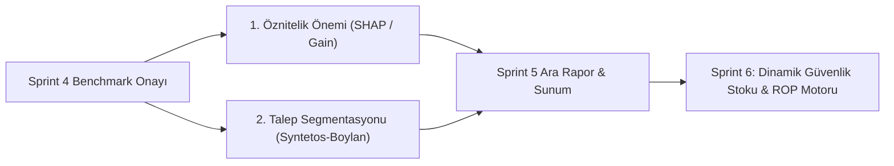

# Sprint 5 Eylem Planı ve Ara Değerlendirme Çerçevesi

> **Proje:** Küçük İşletmeler İçin Yapay Zekâ Destekli Stok Talep Tahmin Sistemi  
> **Sorumlu Roller:** Ö2 (Zaman Serisi & Değerlendirme Lideri) & Ö3 (ML & Stok Modelleme)  
> **Odak:** Öznitelik Önemi (XAI), Hata Dağılımı ve Stok Karar Destek Entegrasyonu

---

## 1. Sprint 5 Amaçları

Sprint 4'te elde edilen benchmark sonuçlarının ardından, Sprint 5 aşağıdaki dört ana hedefe odaklanmaktadır:
1. **Model Açıklanabilirliği (XAI):** Kazanan model olan LightGBM'in hangi özniteliklere dayandığının SHAP ve Gain önem analizleriyle çıkarılması.
2. **Talep Segmentasyonu:** Modellerin performansının aralıklı (*intermittent*) ve hızlı satan (*fast-moving*) ürünlerde ayrı ayrı test edilmesi.
3. **Artık Varyansı & Dağılım Kontrolü:** Tahmin hatalarının normal dağılım varsayımı ve artık standart sapmasının ($\sigma_e$) doğrulanması.
4. **Akademik Ara Proje Raporunun Hazırlanması:** Danışman ve jüri için metodoloji ve ara bulguların derlenmesi.

---

## 2. Detaylı Görev Dağılımı ve İş Paketleri

### İş Paketi 1: Öznitelik Önemi ve Model Açıklanabilirliği (Ö3 & Ö2)
- **Lag Öznitelikleri:** $Lag_{28}, Lag_{35}, Lag_{42}, Lag_{56}$ özniteliklerinin kümülatif katkısı ölçülecek.
- **Düzleştirme Öznitelikleri:** 7 ve 28 günlük kayan ortalama (`rolling_mean_7`, `rolling_mean_28`) ile standart sapmaların etkisi incelenecek.
- **Takvim ve Tatil Etkileri:** Birleşik Krallık resmi tatilleri (`is_holiday`) ve haftanın günleri (`dayofweek`) değişkenlerinin talep sıçramalarını yakalamadaki rolü SHAP özet grafikleriyle görselleştirilecek.

### İş Paketi 2: Talep Karakteristiği Sınıflandırması (Ö1 & Ö2)
Ürünler **Ortalama Talep Aralığı (ADI)** ve **Karesel Varyasyon Katsayısı ($CV^2$)** hesaplanarak 4 kategoriye ayrılacak:
- **Smooth:** $ADI < 1.32, CV^2 < 0.49$
- **Intermittent:** $ADI \ge 1.32, CV^2 < 0.49$
- **Erratic:** $ADI < 1.32, CV^2 \ge 0.49$
- **Lumpy:** $ADI \ge 1.32, CV^2 \ge 0.49$
Her segmentte LightGBM ile MA-28 arasındaki WAPE farkı karşılaştırılarak raporlanacak.

### İş Paketi 3: Tahmin Artık Dağılımı ve Güvenlik Stoku Kalibrasyonu (Ö2)
- Artıkların normal dağılım uygunluğu Q-Q plot ve Shapiro-Wilk testleri ile incelenecek.
- %95 hizmet düzeyi ($z = 1.645$) ve 7 günlük tedarik süresi ($L = 7$) için ürün bazlı güvenlik stoku hesaplama girdileri hazırlanacak:
  $$SS_i = 1.645 \cdot \sigma_{e, i} \cdot \sqrt{7}$$

### İş Paketi 4: Karar Destek Arayüzü İçin Veri Hazırlığı (Ö4 ile Entegrasyon)
- Backtest tahminleri (`results/predictions.parquet`) Streamlit karar destek arayüzüne bağlanarak interaktif karşılaştırma tablosu ve grafikler kullanıma sunulacak.
